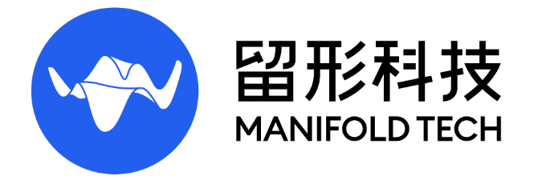

<h2 align="center">Odin Navigation Stack 2 (ONS2)</h2>

<p align="center">
  
  &nbsp;&nbsp;&nbsp;&nbsp;&nbsp;&nbsp;
  
</p>

<p align="center">
  <strong>English</strong> | <a href="README.zh-CN.md">中文</a>
</p>

<div align="center">
  <a href="https://manifoldtechltd.github.io/Odin-Nav-Stack2-Webpage/">
  </a>
  <a href="LICENSE">
  </a>
  <a href="https://wiki.ros.org/noetic">
  </a>
  <a href="https://docs.ros.org/en/jazzy/">
  </a>
</div>

> [!NOTE]
> This repository is under active development. Please refer to the latest code!

**Odin1** is a high-performance spatial sensing module that delivers **high-precision 3D mapping**, **robust relocalization**, and rich sensory streams including **RGB images**, **depth**, **IMU**, **odometry**, and **dense point clouds**. ONS2 builds on Odin1 to provide an autonomous **patrol navigation** stack for ground platforms, enabling:

- **Multi-waypoint autonomous patrol** with dynamic obstacle avoidance
- **Natural-language control** and **Vision-Language Model (VLM)** scene understanding
- **Dual runtime**: the same codebase runs on **ROS1 Noetic** and **ROS2 Jazzy**

## Key Features

- **High-Accuracy SLAM & Persistent Relocalization** (inside Odin1, not open-sourced)  
  Real-time mapping with long-term relocalization using compact binary maps.
- **Dynamic Obstacle-Aware Navigation** (fully open-sourced)  
  Global A\* planning with a memory of blind-spot obstacles (`sliding_map`), combined with the NeuPAN local planner for safe motion in cluttered environments.
- **Mission Management** (fully open-sourced)  
  Multi-waypoint missions with pause, resume, cancel, return-home, final alignment, and per-waypoint dwell.
- **Natural-Language Brain** (fully open-sourced)  
  Routes text commands to missions through rule-based and LLM-based planning. Motion can be disabled with `enable_motion` or at runtime through `/brain/enable`.
- **Vision-Language Integration** (fully open-sourced)  
  Scene question answering through an OpenAI-compatible VLM server.
- **Dual Runtime, Shared Core**  
  `ros_ws/` (ROS1 Noetic) and `ros2_ws/` (ROS2 Jazzy) share the NeuPAN core, the topic / service / action names, and the configuration profiles.

## What's New

- **Dramatically faster planning**  
  Plans substantially faster even on low-compute platforms, with smoother execution and nimbler obstacle avoidance.  
  See the [NeuPAN optimisation notes](docs/neuPAN_optimisation.md) for what was changed and the measured gains.
- **Upgraded VLM, bring your own model**  
  Connect a more capable vision-language model to your own workstation for richer scene understanding.  
  See the [Odin-perception](https://github.com/ManifoldTechLtd/Odin-perception) tutorial for web links and documentation.
- **Built for industrial inspection**  
  Extensive optimizations tuned to real industrial inspection scenarios and long patrol routes.  
  See the [remote web monitor](docs/remote_monitoring.md) — browser-based control console with on-demand camera and intercom (requires your own 4G module, NAT traversal or a public server).
- **End-to-end, fully open source**  
  A complete inspection workflow — simulation to real robots, algorithms to the monitoring platform. See the [Real2Sim tutorial](https://github.com/ManifoldTechLtd/MT-Real2Sim-Tutorial).
- **Plugin architecture**  
  The stack is built around a plugin-based design, making it straightforward to integrate custom planners.
- **More on the way**  
  Further capabilities will land in upcoming releases.

## Related Work

- **[Odin-Nav-Stack](https://github.com/ManifoldTechLtd/Odin-Nav-Stack)** — The ROS1-based open-source navigation stack that this project builds on.
- **[SRU × Odin1: Mapless Navigation with Spatially-Enhanced Recurrent Memory](https://github.com/ManifoldTechLtd/SRU-Odin)** — Mapless navigation on Odin1 (the SRU backend).
- **[NeuPAN (ManifoldTech fork)](https://github.com/ManifoldTechLtd/NeuPAN)** — The local planner used by ONS2, with a ROS wrapper.
- **[ManifoldTech Real2Sim Tutorial](https://github.com/ManifoldTechLtd/MT-Real2Sim-Tutorial)** — Transform the real world into a simulated environment in Isaac Sim using Q9000.
- **[odin_ros_driver](https://github.com/manifoldsdk/odin_ros_driver)** and the [Odin1 wiki](https://manifoldtechltd.github.io/wiki/Odin1/Cover.html) — Odin1 driver and documentation.

# Supported Platforms

| Robot | Runtime | Status |
|---|---|---|
| Unitree Go2 | ROS1 Noetic | Supported (`scripts/ons2_go2.sh`, profile `robots/go2/`) |
| ASTRALL SW01 | ROS1 Noetic / ROS2 Jazzy | Supported (`scripts/ons2_sw01.sh`, profile `robots/sw01/`) |
| Dobot Lumo | ROS1 Noetic | Supported (`scripts/ons2_dobot_lumo.sh`, profile `robots/dobot_lumo/`, defaults to `dry_run=true`) |
| Your own robot | ROS1 or ROS2 | Copy `robots/_template/`; see [03 · Integrate Your Own Robot](docs/usage/03_integrate_your_robot.md) |

Unitree Go2 is supported by the ROS1 stack only.

# Local Planner: NeuPAN or SRU

> [!NOTE]
> SRU will be released soon. Please stay tuned!

By default the stack uses **NeuPAN** (analytic DUNE + NRMP MPC) on a global A\* path. ONS2 can also replace NeuPAN with the **SRU** end-to-end policy, which maps the depth image and the goal directly to velocity commands.

| | NeuPAN (default) | SRU (experimental) |
|---|---|---|
| Global planning | Yes (A\*, `map_planner`) | No |
| Obstacle input | `/scan_360` from `sliding_map` | Odin1 depth image |
| Output | `/cmd_vel` | `/sru/cmd_vel` (5 Hz, body frame), passed to `/cmd_vel` through a motion gate |
| Model | Analytic: no training for a new chassis | ONNX policy: **must be trained for your robot** |
| Select with | Default | `--local-planner=sru` |

## Running NeuPAN

NeuPAN is the default local planner (`--local-planner=neupan`) and requires no neural-network training for new robot footprints:

- **Unitree Go2 (ROS1):**
  ``` shell
  bash scripts/ons2_go2.sh --map=NAME
  ```
- **ASTRALL SW01 (ROS2 or ROS1):**
  ``` shell
  # ROS2 (default)
  bash scripts/ons2_sw01.sh --map=NAME

  # ROS1
  bash scripts/ons2_sw01.sh --ros1 --map=NAME
  ```
- **Dobot Lumo (ROS1):**
  ``` shell
  bash scripts/ons2_dobot_lumo.sh --map=NAME
  ```

For parameter tuning (speed, footprint, safety clearance, stuck escape), see [02 · Parameter Tuning](docs/usage/02_parameter_tuning.md).

## Running SRU

> **SRU requires training.** The trained ONNX models (policy and VAE encoder) are **not included** in this repository. Train the policy in the SRU repository, then deploy the exported models to the SRU workspace on the robot:
>
> **[ManifoldTechLtd/SRU-Odin](https://github.com/ManifoldTechLtd/SRU-Odin)** — training (`Train/`), deployment (`Deployment/`), and the porting guide.

In SRU mode the stack does not plan a global path. It sends each waypoint to SRU in the odom frame, and arrival is judged by odometry distance (`sru_arrive_threshold_m` in `nav_params.yaml`, 0.7 m by default). Route segmentation, periodic replanning, recovery, and the hot path are disabled.

Pass `--local-planner=sru` to any platform launcher to switch from NeuPAN to the SRU policy:

- **Unitree Go2 (ROS1):**
  ``` shell
  export SRU_WS=/path/to/sru_ros1_workspace
  bash scripts/ons2_go2.sh --local-planner=sru --map=NAME
  # Optional: select a specific policy file with --sru-policy=FILE
  ```
- **ASTRALL SW01 (ROS2 or ROS1):**
  ``` shell
  # ROS2 (default)
  export SRU_WS_ROS2=/path/to/sru_ros2_workspace
  bash scripts/ons2_sw01.sh --local-planner=sru --map=NAME

  # ROS1
  export SRU_WS=/path/to/sru_ros1_workspace
  bash scripts/ons2_sw01.sh --ros1 --local-planner=sru --map=NAME
  ```
- **Dobot Lumo (ROS1):**
  ``` shell
  export SRU_WS=/path/to/sru_ros1_workspace
  bash scripts/ons2_dobot_lumo.sh --local-planner=sru --map=NAME
  ```

Common notes:
- On ROS2, the launcher starts the SRU policy node and velocity relay via `ros2_ws/scripts/sru/start_sru_ros2.sh` and `ros2_ws/scripts/sru/sru_cmd_vel_relay.py` (models default to `$SRU_WS_ROS2/Deployment/models`, overridable via `SRU_MODELS_DIR`).
- On ROS1, the SRU helper defaults to `sru_nav_go2_ros1`; set `SRU_PKG` and `SRU_LAUNCH` (or configure `planner.local` in `robots/<robot>/robot.yaml`) to point to your robot's SRU package and launch file.
- `--navigation-mode` has no effect in SRU mode.
- SRU outputs a body-frame `Twist`, so any robot with a `/cmd_vel` bridge can use it. See [03 · Integrate Your Own Robot](docs/usage/03_integrate_your_robot.md).

# Installation and Build

Both runtimes share the same clone step and the same Odin1 USB rule. Then follow **one** runtime section below.

## Common steps

### 1. Clone the repository

``` shell
git clone --recursive https://github.com/ManifoldTechLtd/Odin-Nav-Stack2.git
cd Odin-Nav-Stack2
```

If you cloned without `--recursive`:

``` shell
git submodule update --init ros_ws/src/odin_ros_driver   # ROS1 Odin1 driver (submodule)
git submodule update --init yolov5                       # optional: object detection
git submodule update --init odin_rtk_fusion              # optional: RTK input
```

The ROS2 Odin1 driver `ros2_ws/src/odin_ros_driver` is an in-tree copy of [manifoldsdk/odin_ros_driver](https://github.com/manifoldsdk/odin_ros_driver/), not a submodule.

### 2. Odin1 USB rule

``` shell
sudo vim /etc/udev/rules.d/99-odin-usb.rules
```

Add this line, then reload the rules and reinsert the device:

``` shell
SUBSYSTEM=="usb", ATTR{idVendor}=="2207", ATTR{idProduct}=="0019", MODE="0666", GROUP="plugdev"
```

``` shell
sudo udevadm control --reload && sudo udevadm trigger
```

## ROS1 Noetic (Ubuntu 20.04)

ROS1 runs NeuPAN, which requires **Python ≥ 3.10**. The system Python on Ubuntu 20.04 is 3.8, so install ROS and NeuPAN into a conda environment.

### Install

``` shell
conda install -n base -c conda-forge mamba        # then re-login to the shell
mamba create -n neupan -y
mamba activate neupan
conda config --env --add channels conda-forge
conda config --env --remove channels defaults
conda config --env --add channels robostack-noetic
mamba install -n neupan ros-noetic-desktop colcon-common-extensions catkin_tools rosdep ros-dev-tools -y
pip install torch --index-url https://download.pytorch.org/whl/cpu   # on Jetson, use the NVIDIA wheel
pip install -e NeuPAN
python --version                                  # must be 3.10 or newer
```

Tell the launch scripts which interpreter runs NeuPAN:

``` shell
export NEUPAN_PYTHON="$(which python)"
```

### Build

Install the Unitree SDK first: `ros_ws/src/unitree_control` calls `find_package(unitree_sdk2)`. Then build all ROS1 packages:

``` shell
bash ros_ws/src/odin_ros_driver/script/build_ros.sh
```

This is the same as `cd ros_ws && catkin_make -DCMAKE_BUILD_TYPE=Release`.

- **No Unitree SDK?** Build only the packages you need: `catkin_make -DCATKIN_WHITELIST_PACKAGES="nav_interfaces;odin_ros_driver;map_planner;sliding_map;neupan_ros;mission_manager;atomic_move;sw01_ros_control"`.
- **Dobot Lumo** is optional. Without the Lumo SDK, `dobot_ros_control` builds the raw RPC backend only.
- Build artifacts are tied to the machine architecture. Rebuild after moving to another board.

### Launch

``` shell
bash scripts/ons2_go2.sh --map=NAME                            # Unitree Go2 (ROS1)
bash scripts/ons2_dobot_lumo.sh --map=NAME                     # Dobot Lumo (ROS1)
```

Stop: `bash scripts/ons2_go2_stop.sh` (Go2) or `bash scripts/ons2_dobot_lumo_stop.sh` (Dobot Lumo).

## ROS2 Jazzy (Ubuntu 24.04)

ROS2 targets the **ASTRALL SW01** platform. It uses the system Python 3.12 and does not need conda.

### Install

``` shell
sudo apt update
sudo apt install -y \
  ros-jazzy-ros-base ros-jazzy-tf2-ros ros-jazzy-tf2-geometry-msgs \
  ros-jazzy-pcl-ros ros-jazzy-pcl-conversions ros-jazzy-cv-bridge ros-jazzy-image-transport \
  ros-jazzy-pointcloud-to-laserscan ros-jazzy-rosbridge-suite ros-jazzy-nav-msgs \
  ros-jazzy-sensor-msgs ros-jazzy-std-srvs ros-jazzy-message-filters \
  ros-jazzy-rosidl-default-generators ros-jazzy-rosidl-default-runtime \
  ros-jazzy-nav2-map-server ros-jazzy-foxglove-bridge

python3 -m pip install --break-system-packages "numpy<2" scipy cvxpy cvxpylayers ecos \
  matplotlib rich pyyaml scikit-learn loguru "gctl==1.2" \
  torch --index-url https://download.pytorch.org/whl/cpu --extra-index-url https://pypi.org/simple
```

> Keep `numpy` below 2.0. NeuPAN/cvxpy and the ROS2 `cv_bridge` build depend on it. NeuPAN is not installed with pip; the launch scripts add `NeuPAN/` to `PYTHONPATH`.

### Build and Launch

``` shell
source /opt/ros/jazzy/setup.bash
cd ros2_ws
colcon build --symlink-install
cd ..
bash scripts/ons2_sw01.sh --map=NAME                           # ASTRALL SW01 (ROS2)
```

Stop: `bash scripts/ons2_sw01_stop.sh`. Use `ROS_DOMAIN_ID=98` in every terminal you open by hand; the launch script sets it by default.

## Differences between ROS1 and ROS2

| Item | ROS1 (Noetic) | ROS2 (Jazzy) |
|---|---|---|
| OS | Ubuntu 20.04 | Ubuntu 24.04 |
| Python for NeuPAN | System `python3` or `NEUPAN_PYTHON` (Python ≥ 3.10) | System Python 3.12 (`pip --break-system-packages`) |
| Build | `catkin_make` / `build_ros.sh` | `colcon build --symlink-install` |
| Discovery | `roscore` (started by the launcher) | DDS, `ROS_DOMAIN_ID=98`, no `roscore` |
| Launcher | `scripts/ons2_go2.sh`, `scripts/ons2_dobot_lumo.sh` | `scripts/ons2_sw01.sh` |
| `--navigation-mode` | Optional (defaults to `replan_periodic`) | Optional (defaults to `replan_periodic`) |
| Stop | `scripts/ons2_go2_stop.sh`, `scripts/ons2_dobot_lumo_stop.sh` | `scripts/ons2_sw01_stop.sh` |
| tmux session | `ons2_go2`, `ons2_dobot_lumo` | `ons2_sw01` |
| Mission CLI / TUI | `ros_ws/scripts/test_nav_control_rospy.py` or `scripts/tools/mission_cli.sh` | `ros2_ws/scripts/test_nav_control_ros2.py` or `ros2 service call` |
| Robots | Go2, Dobot Lumo, SW01 | SW01 |
| Odin driver | Submodule `ros_ws/src/odin_ros_driver` | In-tree copy `ros2_ws/src/odin_ros_driver` |

# Documentation

## Feature index — start from what you want to do

| I want to… | Read |
|---|---|
| **Run a patrol mission** on an existing robot | [01 · Quick Start](docs/usage/01_quick_start.md) |
| **Drive it from a browser** (Foxglove, or the optional 3DGS console) | [Quick Start § 5 · Web Control Frontend](docs/usage/01_quick_start.md#5-web-control-frontend) |
| **Operate it remotely over 4G / NAT** — *ROS 2 (SW01) only; ROS 1 not supported yet* | [Remote Web Monitor](docs/remote_monitoring.md) |
| **Understand or retune the local planner** — what was optimised and why | [NeuPAN Optimisation Notes](docs/neuPAN_optimisation.md) |
| **Look up a parameter by name**, or debug a symptom | [Advanced Tuning & Troubleshooting](docs/TUNING_GUIDE.md) |
| **Pick or write a platform profile** | [Robot Profiles](docs/architecture/ROBOT_PROFILE.md) |
| **Add automated inspection** — checklist verdicts, annotated frames | [Perception guide](perception/README.md) → [Odin-perception](https://github.com/ManifoldTechLtd/Odin-perception) |
| **Connect a new robot** — interface contract, chassis bridge, TF, launch | [03 · Integrate Your Own Robot](docs/usage/03_integrate_your_robot.md) |
| **Ask a VLM questions about the scene** | [VLM Scene Understanding](#vlm-scene-understanding) |
| **Control the robot in natural language** | [Natural-Language Control (odin_brain)](#natural-language-control-odin_brain) |
| **Understand the architecture / module dataflow** | [Architecture](docs/architecture/ONS2_ARCHITECTURE.md) · [Module Dataflow](docs/architecture/MODULE_DATAFLOW.md) |
| **Scan a site and build a navigation map** (Q9000) | [Q9000 Tutorial](docs/Q9000-tutorial/Q9000-tutorial.md) · [`pcd_to_pgm.py`](scripts/map_processing/pcd_to_pgm.py) |
| **Reproduce a scenario in simulation** (Real2Sim) | [MT-Real2Sim-Tutorial](https://github.com/ManifoldTechLtd/MT-Real2Sim-Tutorial) |
| **Deploy with Docker** (Jetson, ROS1) | [docker/docker-compose.yml](docker/docker-compose.yml) |

> **Chinese docs:** the tuning guide, NeuPAN notes and remote monitor are also available as
> `*.zh-CN.md` next to each English file. The README itself has a [中文版](README.zh-CN.md).

## Core guides

| # | Guide | Use it to |
|---|---|---|
| 1 | [Quick Start for Existing Robots](docs/usage/01_quick_start.md) | Start the stack on Go2, SW01, or Dobot Lumo, and send missions |
| 2 | [Parameter Tuning](docs/usage/02_parameter_tuning.md) | Change speed, footprint, clearance, and tracking for each platform |
| 3 | [Integrate Your Own Robot](docs/usage/03_integrate_your_robot.md) | Connect a new robot: interface contract, chassis bridge, TF, launch |

## Feature status at a glance

| Capability | ROS 1 (Noetic) | ROS 2 (Jazzy) |
|---|---|---|
| Patrol navigation, local/global planning | ✅ | ✅ |
| Web control console (Foxglove) | ✅ | ✅ |
| Inspection perception (Florence-2, separate repo) | ✅ | ✅ |
| Natural-language control (`odin_brain`) | ✅ | ✅ |
| Remote web monitor (camera / intercom / e-stop) | ❌ not yet | ✅ SW01 |

## Natural-Language Control (odin_brain)

`odin_brain` accepts text on `/brain/command` and turns it into missions. In ROS2:

``` shell
mkdir -p ~/.config/odin_brain
cp ros2_ws/src/odin_brain/config/llm.env.example ~/.config/odin_brain/llm.env
chmod 600 ~/.config/odin_brain/llm.env        # fill in your LLM API key
ros2 run odin_brain check_llm                 # verify the LLM connection
ros2 run odin_brain brain_node                # start the resident node
```

The brain never publishes `/cmd_vel` directly. It only calls the mission services.

## VLM Scene Understanding

Start a VLM server (llama.cpp, OpenAI-compatible API), then the terminal client:

``` shell
llama-server -m SmolVLM-500M-Instruct-Q8_0.gguf --mmproj mmproj-SmolVLM-500M-Instruct-Q8_0.gguf
ros2 launch odin_vlm_terminal odin_vlm_terminal.launch.py     # ROS2
roslaunch odin_vlm_terminal odin_vlm_terminal.launch          # ROS1
```

On an onboard computer with limited resources, run the VLM server on a companion machine.

## Inspection Perception (Florence-2)

> **Optional module — ONS2 runs fully without it.** Adding perception is a two-process
> side-car, not a rebuild: you do not have to recompile this stack, touch its launch files,
> or change any navigation parameter. You can add it or drop it at any time.

**Do you need it?**

| You need Odin-perception if… | You do **not** need it if… |
|---|---|
| Patrols must produce **pass/fail verdicts** (valve state, gauge readings, indicator colors, nameplate OCR) | You only need the robot to **navigate** between waypoints |
| You want **annotated images** (boxes + verdict text) on the camera feed | A human watches the video stream and decides |
| Your Odin1 camera can publish RGB (`sendrgb: 1`) | Your platform has no RGB stream |

For **structured inspection** — valve closed? gauge reading? indicator color? — the perception
component lives in a **separate open-source repository**, so the model environment never has to
be merged into this ROS workspace:

**➡️ [Odin-perception](https://github.com/ManifoldTechLtd/Odin-perception)**

It takes an image, returns decidable verdicts against a YAML/JSON checklist, and can publish an
annotated image (detection boxes + verdict text). It attaches to this stack in two processes
communicating over HTTP:

```
odin driver ──► /odin1/image/undistorted
                      │
        ros1/ros2 capture node (:8730) ──HTTP──► perception-run (Florence-2)
                      ▲                                   │
                      └───────── POST /annotate ◄─────────┘
                      │
        /inspection/annotated/compressed ──► Foxglove / RViz / rosbridge
```

**Installation and integration are documented in that repository's README** — see its
*Integrating with Odin-Nav-Stack2* section for the step-by-step procedure, the topic contract,
and the ROS 1 / Jetson pitfalls.

Prerequisite on this side: the Odin driver must actually publish images, i.e. `sendrgb: 1` and
`sendrgbundistort: 1` in the driver's `control_command.yaml`; verify with
`rostopic hz /odin1/image/undistorted` before wiring perception in.

> `odin_vlm_terminal` above is a different, lightweight path: it forwards frames to an
> OpenAI-compatible VLM server for free-form Q&A. Use Odin-perception when you need repeatable,
> checklist-driven inspection verdicts.

# Architecture

The stack is layered: Odin1 sensing and TF → `pointcloud_to_laserscan` → `sliding_map` obstacle memory → A\* global planning (`map_planner`) → NeuPAN local control (`neupan_ros`) → chassis bridge, coordinated by `mission_manager`. Only one node may publish `/cmd_vel` at a time. Control passes from NeuPAN to `atomic_move` through `/neupan/stop`.

# Repository Structure

```text
Odin-Nav-Stack2/
├── robots/                        # Single source of truth for per-robot profiles
│   ├── _template/                 # Template for new robots (robot.yaml + neupan/{config,planner}.yaml)
│   ├── go2/                       # Unitree Go2 profile & NeuPAN configs (ROS 1)
│   ├── sw01/                      # ASTRALL SW01 profile & NeuPAN configs (ROS 2)
│   └── dobot_lumo/                # Dobot Lumo profile & NeuPAN configs (ROS 1)
├── scripts/                       # Unified entry scripts & operational tools
│   ├── ons2_go2.sh / ons2_go2_stop.sh
│   ├── ons2_sw01.sh / ons2_sw01_stop.sh
│   ├── ons2_dobot_lumo.sh / ons2_dobot_lumo_stop.sh
│   └── lib/ | brain/ | tools/ | systemd/ | map_processing/
├── ros_ws/                        # ROS 1 Noetic workspace
│   ├── scripts/                   # ROS 1 runtime scripts (test_nav_control_rospy.py, waypoint_goal_bridge.py, sru/, ...)
│   └── src/
│       ├── ons2_bringup/          # Profile-driven ROS 1 launch files (go2, dobot, map_planner, neupan)
│       ├── nav_interfaces/        # Shared messages, services, and actions
│       ├── sliding_map/           # 360° ego-centric virtual scan & obstacle memory
│       ├── map_planner/           # Global 2D A* planner & scan temporal filter
│       ├── neupan_ros/            # ROS 1 action server wrapper for NeuPAN
│       ├── mission_manager/       # Multi-waypoint mission state machine
│       ├── atomic_move/           # Closed-loop move / turn / align services
│       ├── unitree_control/       # Unitree Go2 SDK2 velocity bridge
│       ├── dobot_ros_control/     # Dobot Lumo RPC velocity bridge & O1L launch
│       ├── odin_brain/            # Natural-language planner & Hermes web plugin
│       └── odin_vlm_terminal/     # VLM scene question-answering node
├── ros2_ws/                       # ROS 2 Jazzy workspace (1:1 core parity with ros_ws)
│   ├── scripts/                   # ROS 2 runtime scripts (test_nav_control_ros2.py, waypoint_goal_bridge.py, sru/, ...)
│   └── src/
│       ├── ons2_bringup/          # Generic profile-driven bringup.launch.py
│       ├── nav_interfaces/        # ROS 2 IDL messages, services, and actions
│       ├── sliding_map/           # ROS 2 360° virtual scan & obstacle memory
│       ├── map_planner/           # ROS 2 global A* planner & cloud/scan filters
│       ├── neupan_ros/            # ROS 2 action server + ros2_shim.py
│       ├── mission_manager/       # ROS 2 mission state machine & path safety validator
│       ├── atomic_move/           # ROS 2 closed-loop alignment node
│       ├── sw01_ros_control/      # ASTRALL SW01 SDK velocity bridge
│       ├── odin_brain/            # ROS 2 natural-language planner
│       └── odin_vlm_terminal/     # ROS 2 VLM scene question-answering node
├── NeuPAN/                        # Shared MPC + analytic DUNE local planner core (Python)
├── perception/                    # Guide & clone instructions for ManifoldTechLtd/Odin-perception
├── docker/                        # Docker setup for Jetson (ROS 1)
└── docs/                          # Documentation
    ├── usage/                     # 01_quick_start, 02_parameter_tuning, 03_integrate_your_robot
    ├── architecture/              # ROBOT_PROFILE.md, ONS2_ARCHITECTURE.md, MODULE_DATAFLOW.md
    └── TUNING_GUIDE.md            # Detailed parameter dictionary & troubleshooting reference
```

# FAQ

## How do I check relocalization?

Open RViz (`rviz` on ROS1, `rviz2` on ROS2), set the fixed frame to `map`, and add the `TF` display. Relocalization succeeded when `map → odom → odin1_base_link` is connected.

## The start or goal is occupied after I publish a goal

Check the inflated map (`/inflated_map`) in RViz. The start and goal must lie outside the inflation area. Adjust `navigation.inflation_radius` in `robots/<robot>/robot.yaml`.

## The robot does not stop near the target

This is a NeuPAN tolerance issue. See [02 · Parameter Tuning](docs/usage/02_parameter_tuning.md) and the [tuning guide](docs/TUNING_GUIDE.md).

## ROS2 nodes run but cannot see each other

All nodes must use the same DDS domain, `ROS_DOMAIN_ID=98`. Set it in every terminal you open by hand.

# Acknowledgements

Thanks to the excellent work by [ROS Navigation](https://github.com/ros-planning/navigation), [NeuPAN](https://github.com/hanruihua/NeuPAN), and [Ultralytics YOLO](https://github.com/ultralytics/ultralytics).

Special thanks to [hanruihua](https://github.com/hanruihua) and the Odin1 team at Manifold Tech.

# License

ONS2 is released under the [GNU General Public License v3.0](LICENSE). Third-party components keep their own licenses; the full list includes NeuPAN (GPL-3.0), the Odin1 driver (Apache-2.0), `yolov5` (AGPL-3.0, optional submodule), and the ASTRALL SDK (proprietary, not distributed with this repository). Check the license of each component before redistributing it.
