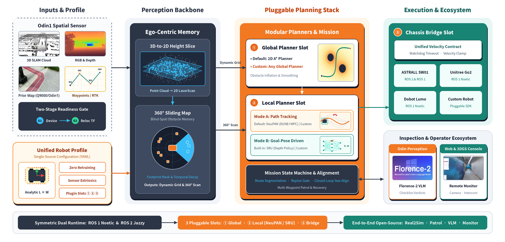

<h2 align="center">Odin Navigation Stack 2 (ONS2)</h2>

<p align="center">
  
  &nbsp;&nbsp;&nbsp;&nbsp;&nbsp;&nbsp;
  
</p>

<p align="center">
  <a href="README.md">English</a> | <strong>中文</strong>
</p>

<div align="center">
  <a href="https://manifoldtechltd.github.io/Odin-Nav-Stack2-Webpage/">
  </a>
  <a href="LICENSE">
  </a>
  <a href="https://wiki.ros.org/noetic">
  </a>
  <a href="https://docs.ros.org/en/jazzy/">
  </a>
</div>

> [!NOTE]
> 本仓库持续更新中，请以最新代码为准！

**Odin1** 是一款高性能空间感知模块，可提供**高精度 3D 建图**、**鲁棒的重定位**，以及包括 **RGB 图像**、**深度**、**IMU**、**里程计**和**稠密点云**在内的丰富感知数据流。ONS2 在 Odin1 的基础上，为地面平台提供自主**巡逻导航**栈，支持：

- **多航点自主巡逻**，具备动态避障能力和远程监控能力
- **自然语言控制**与**视觉语言模型（VLM）**场景理解
- **双运行时**：同一套代码可运行在 **ROS1 Noetic** 和 **ROS2 Jazzy** 上

<p align="center">
  
</p>

# 1. 概览

## 1.1 核心特性

- **高精度 SLAM 与持久重定位**（位于 Odin1 内部，未开源）  
  实时建图，并利用紧凑的二进制地图进行长期重定位。
- **动态障碍物感知导航**（完全开源）  
  带盲区障碍物记忆（`sliding_map`）的全局规划，结合 NeuPAN/SRU 局部规划器，在杂乱环境中也能安全运动。
- **任务管理**（完全开源）  
  支持多航点任务，包括暂停、恢复、取消、返航、最终对准、每个航点的停留以及远程监控平台。
- **自然语言大脑**（完全开源）  
  通过基于 VLM 的感知检测，用户可以接入VLM实现自定义的物体检查和场景问答功能。
- **双运行时，共享核心**  
  `ros_ws/`（ROS1 Noetic）与 `ros2_ws/`（ROS2 Jazzy）共享规划器核心、话题/服务/动作名称以及配置档位。

## 1.2 新增内容

- **规划速度大幅提升**  
  即使在低算力平台上也能显著加快规划速度，运动执行更加平滑，避障更加敏捷。  
  具体修改和实测收益，见 [NeuPAN 优化说明](docs/neuPAN_optimisation.zh-CN.md)。
- **升级版 VLM，支持接入自有模型**  
  可在你自己的工作站上连接更强大的视觉语言模型，实现更丰富的场景理解。  
  参见 [Odin-perception](https://github.com/ManifoldTechLtd/Odin-perception) 教程，内有网页链接与文档说明。
- **专为工业巡检打造**  
  针对真实工业巡检场景与长距离巡逻路线进行了大量专项优化。  
  远程 Web 监控界面见 [remote_monitoring.zh-CN.md](docs/remote_monitoring.zh-CN.md)（**仅璇玑SW01+ROS 2适配**）—— 浏览器控制台，按需开相机与语音喊话（需自备 4G 模块、内网穿透或公网服务器）。
- **端到端，完全开源**  
  完整的巡检工作流——从仿真到实机、从算法到监控平台。真实世界到仿真世界，参见 [Real2Sim 教程](https://github.com/ManifoldTechLtd/MT-Real2Sim-Tutorial)。
- **Odin RTK融合导航**
  使用Odin和RTK快速完成配置，可完整实现基于经纬度的导航，以及扩展更多的使用场景。
- **插件化架构**  
  整个导航栈围绕插件化设计构建，可轻松接入自定义规划器。
- **更多功能即将推出**  
  后续版本将持续带来更多新能力。

## 1.3 相关工作

- **[Odin-Nav-Stack](https://github.com/ManifoldTechLtd/Odin-Nav-Stack)** —— 本项目所基于的 ROS1 开源导航栈。
- **[SRU × Odin1: Mapless Navigation with Spatially-Enhanced Recurrent Memory](https://github.com/ManifoldTechLtd/SRU-Odin)** —— Odin1 上的无地图导航（SRU 后端）。
- **[NeuPAN（ManifoldTech 分支）](https://github.com/ManifoldTechLtd/NeuPAN)** —— ONS2 使用的局部规划器，带 ROS 封装。
- **[ManifoldTech Real2Sim 教程](https://github.com/ManifoldTechLtd/MT-Real2Sim-Tutorial)** —— 使用 Q9000 将真实世界转换为 Isaac Sim 中的仿真环境。
- **[odin_ros_driver](https://github.com/manifoldsdk/odin_ros_driver)** 与 [Odin1 wiki](https://manifoldtechltd.github.io/wiki/Odin1/Cover.html) —— Odin1 驱动与文档。
- **[Odin RTK](https://github.com/ManifoldTechLtd/Odin-RTK)** —— Odin RTK Fusion，把 Odin SLAM 里程计与 RTK/GNSS 的 GGA 数据融合，输出带全局参考的位姿。
- **[Odin Perception](https://github.com/ManifoldTechLtd/Odin-perception)** —— ONS2 的端侧巡检感知组件：把一帧图像交给视觉模型，按结构化检查清单输出可判定的结论（yes/no、状态、计数、读字、描述），并保留证据图与耗时。

# 2. 支持的平台

| 机器人 | 运行时 | 状态 |
|---|---|---|
| ASTRALL SW01 | ROS1 Noetic / ROS2 Jazzy | 支持（`scripts/ons2_sw01.sh`，配置 `robots/sw01/`），并经过大量验证测试和针对性优化 |
| Unitree Go2 | ROS1 Noetic | 支持（`scripts/ons2_go2.sh`，配置 `robots/go2/`） |
| Dobot Lumo | ROS1 Noetic | 支持（`scripts/ons2_dobot_lumo.sh`，配置 `robots/dobot_lumo/`，默认 `dry_run=true`） |
| 你自己的机器人 | ROS1 或 ROS2 | 复制 `robots/_template/`；见 [03 · 接入你自己的机器人](docs/usage/03_integrate_your_robot.md) |

Unitree Go2 仅由 ROS1 栈支持。

# 3. 局部规划器：NeuPAN 或 SRU

> [!NOTE]
> SRU 训练代码已发布。融入导航的 SRU 将在近期发布。敬请期待！

默认情况下，该栈在全局 A\* 路径上使用 **NeuPAN**。ONS2 也可以用 **SRU** 端到端策略替代 NeuPAN，后者直接将深度图像和目标映射为速度指令。

| | NeuPAN（默认） | SRU（实验性） |
|---|---|---|
| 全局规划 | 是（A\*，`map_planner`） | 否 |
| 障碍物输入 | 来自 `sliding_map` 的 `/scan_360` | Odin1 深度图像 |
| 输出 | `/cmd_vel` | `/sru/cmd_vel`（5 Hz，机体坐标系），经运动门限传给 `/cmd_vel` |
| 模型 | 解析式：新底盘无需训练 | ONNX 策略：**必须针对你的机器人训练** |
| 选择方式 | 默认 | `--local-planner=sru` |

## 3.1 运行 NeuPAN

NeuPAN 是默认的局部规划器（`--local-planner=neupan`），适配新机器人底盘尺寸时无需任何神经网络训练：

- **Unitree Go2（ROS1）：**
  ``` shell
  bash scripts/ons2_go2.sh --map=NAME
  ```
- **ASTRALL SW01（ROS2 或 ROS1）：**
  ``` shell
  # ROS2（默认）
  bash scripts/ons2_sw01.sh --map=NAME

  # ROS1
  bash scripts/ons2_sw01.sh --ros1 --map=NAME
  ```
- **Dobot Lumo（ROS1）：**
  ``` shell
  bash scripts/ons2_dobot_lumo.sh --map=NAME
  ```

> `--map=NAME`（例如 `--map=parkinglot`）用于指定建好的地图前缀（对应同名的 `NAME.yaml`、`NAME.pgm` 和 `customer_file/NAME.bin` 三个文件）。关于使用 Q9000 或 Odin1 建图、转换与存放目录的详细说明，请参考 [地图构建与处理指南](docs/map-tutorial/map-tutorial.zh-CN.md)。

参数调优（速度、底盘尺寸、安全间隙、脱困策略）请参见 [02 · 参数调优](docs/usage/02_parameter_tuning.md)。

## 3.2 运行 SRU

> **SRU 需要训练。** 请联系厂家获得机器人的运控。训练好的 ONNX 模型（策略和 VAE 编码器）**不包含**在本仓库中。请在 SRU 仓库中训练策略，然后将导出的模型部署到机器人上的 SRU 工作空间：
>
> **[ManifoldTechLtd/SRU-Odin](https://github.com/ManifoldTechLtd/SRU-Odin)** —— 训练（`Train/`）、部署（`Deployment/`）与移植指南。

在 SRU 模式下，该栈不规划全局路径。它将每个航点以 odom 坐标系发送给 SRU，并根据里程计距离判断是否到达（`nav_params.yaml` 中的 `sru_arrive_threshold_m`，默认 0.7 m）。路线分段、周期性重规划、恢复和热路径均被禁用。

在任一平台启动脚本中传入 `--local-planner=sru`，即可将局部规划器从 NeuPAN 切换为 SRU 策略：

- **Unitree Go2（ROS1）：**
  ``` shell
  export SRU_WS=/path/to/sru_ros1_workspace
  bash scripts/ons2_go2.sh --local-planner=sru --map=NAME
  # 可选：通过 --sru-policy=FILE 指定策略模型文件
  ```
- **ASTRALL SW01（ROS2 或 ROS1）：**
  ``` shell
  # ROS2（默认）
  export SRU_WS_ROS2=/path/to/sru_ros2_workspace
  bash scripts/ons2_sw01.sh --local-planner=sru --map=NAME

  # ROS1
  export SRU_WS=/path/to/sru_ros1_workspace
  bash scripts/ons2_sw01.sh --ros1 --local-planner=sru --map=NAME
  ```

通用说明：
- 在 ROS2 下，启动脚本通过 `ros2_ws/scripts/sru/start_sru_ros2.sh` 与 `ros2_ws/scripts/sru/sru_cmd_vel_relay.py` 启动 SRU 策略节点与速度门控 relay（模型默认从 `$SRU_WS_ROS2/Deployment/models` 读取，可通过 `SRU_MODELS_DIR` 覆盖）。
- 在 ROS1 下，SRU 启动脚本默认使用 `sru_nav_go2_ros1`；可通过设置 `SRU_PKG` 和 `SRU_LAUNCH`（或在 `robots/<robot>/robot.yaml` 的 `planner.local` 中配置）指定对应机器人的 SRU 包和 launch 文件。
- `--navigation-mode` 在 SRU 模式下无效。
- SRU 输出机体坐标系下的 `Twist`，因此任何具备 `/cmd_vel` 桥接的机器人都可以使用。详见 [03 · 接入你自己的机器人](docs/usage/03_integrate_your_robot.md)。

# 4. 安装与构建

两种运行时共用相同的克隆步骤和相同的 Odin1 USB 规则。然后按下面**其中一个**运行时章节操作。

## 4.1 通用步骤

### 4.1.1 克隆仓库

``` shell
git clone --recursive https://github.com/ManifoldTechLtd/Odin-Nav-Stack2.git
cd Odin-Nav-Stack2
```

如果你没有使用 `--recursive` 克隆：

``` shell
git submodule update --init ros_ws/src/odin_ros_driver    # ROS1 Odin1 驱动（子模块）
git submodule update --init ros2_ws/src/odin_ros_driver   # ROS2 Odin1 驱动（子模块）
git submodule update --init yolov5                        # 可选：目标检测
git submodule update --init odin_rtk_fusion               # 可选：RTK 输入
```

`ros_ws/src/odin_ros_driver` 与 `ros2_ws/src/odin_ros_driver` 均为指向 [manifoldsdk/odin_ros_driver](https://github.com/manifoldsdk/odin_ros_driver/) 的子模块。

### 4.1.2 Odin1 USB 规则

具体可参考 [Odin1 Ubuntu 快速上手 —— 创建 udev 规则](https://manifoldtechltd.github.io/wiki/en/odin_series/odin1/7.%20Odin1%20Quick%20start%20for%20ubuntu.html#74-create-udev-rules)：

``` shell
sudo vim /etc/udev/rules.d/99-odin-usb.rules
```

添加下面这一行，然后重新加载规则并重新插入设备：

``` shell
SUBSYSTEM=="usb", ATTR{idVendor}=="2207", ATTR{idProduct}=="0019", MODE="0666", GROUP="plugdev"
```

``` shell
sudo udevadm control --reload && sudo udevadm trigger
```

## 4.2 ROS1 Noetic（Ubuntu 20.04）

ROS1 和 ROS2 默认都使用 **NeuPAN** 局部规划器（`NeuPAN/` 要求 **Python ≥ 3.10**）。由于 Ubuntu 20.04 系统自带的 Python 为 3.8，需要为 NeuPAN 单独创建一个 Python 3.10 的 conda 或者 venv 环境（下方以conda示例），而 ROS1 的 C++ 功能包则直接基于系统安装的 ROS Noetic 编译。

### 4.2.1 安装

1. **安装系统 ROS1 依赖包：**
   ``` shell
   sudo apt update
   sudo apt install -y \
     ros-noetic-tf2-ros ros-noetic-tf2-geometry-msgs ros-noetic-tf2-eigen \
     ros-noetic-cv-bridge ros-noetic-image-transport ros-noetic-pcl-ros \
     ros-noetic-pointcloud-to-laserscan ros-noetic-map-server \
     ros-noetic-rosbridge-suite ros-noetic-foxglove-bridge
   ```

2. **创建用于运行 NeuPAN 局部规划器的 Python ≥ 3.10 环境：**
   ``` shell
   conda create -n neupan python=3.10 -y
   conda activate neupan
   pip install rospkg catkin_pkg
   pip install torch --index-url https://download.pytorch.org/whl/cpu   # 在 Jetson 上请使用对应的 NVIDIA JetPack wheel
   pip install -e NeuPAN
   export NEUPAN_PYTHON="$(which python)"
   ```
   *（可选替代方案：如果主机未安装系统级 `/opt/ros/noetic`，也可以通过 `mamba` 和 `robostack-noetic` 频道在虚拟环境内安装完整的 `ros-noetic-desktop`。）*

### 4.2.2 构建

1. **按你的机器人机型准备底盘 SDK：**
   - **Unitree Go2：** 请先按官方指南安装 [unitree_sdk2](https://github.com/unitreerobotics/unitree_sdk2)（亦可参考[宇树 SDK 开发者文档](https://support.unitree.com/home/zh/developer/Obtain%20SDK)），因为 `ros_ws/src/unitree_control` 依赖 `find_package(unitree_sdk2)`。
   - **ASTRALL SW01：** SW01 底盘 SDK 与驱动支持由 ASTRALL Dynamics（璇玑动力）提供，请通过其官网联系获取：[https://www.astralldynamics.com/index.html](https://www.astralldynamics.com/index.html)。
   - **Dobot Lumo：** SDK 为可选项；未安装 Lumo SDK 时，`dobot_ros_control` 会自动只编译原生 RPC 后端。

2. **编译 ROS1 工作空间：**
   ``` shell
   # 全量编译（已安装 unitree_sdk2 时）：
   bash ros_ws/src/odin_ros_driver/script/build_ros.sh
   # 等同于：cd ros_ws && catkin_make -DCMAKE_BUILD_TYPE=Release

   # 跳过 unitree_control 编译（适用于 SW01、Dobot Lumo 或自定义机器人）：
   cd ros_ws && catkin_make -DCMAKE_BUILD_TYPE=Release \
     -DCATKIN_WHITELIST_PACKAGES="nav_interfaces;odin_ros_driver;map_planner;sliding_map;neupan_ros;mission_manager;atomic_move;sw01_ros_control;dobot_ros_control"
   ```

### 4.2.3 启动

``` shell
bash scripts/ons2_go2.sh --map=NAME                            # Unitree Go2 (ROS1)
bash scripts/ons2_dobot_lumo.sh --map=NAME                     # Dobot Lumo (ROS1)
bash scripts/ons2_sw01.sh --ros1 --map=NAME                    # ASTRALL SW01 (ROS1)
```

停止：`bash scripts/ons2_go2_stop.sh`、`bash scripts/ons2_dobot_lumo_stop.sh` 或 `bash scripts/ons2_sw01_stop.sh`。

## 4.3 ROS2 Jazzy（Ubuntu 24.04）

ROS2 导航栈（`ros2_ws/`）已在 **ASTRALL SW01** 上完成验证，同时支持任何通过 `robots/<robot>/robot.yaml` 接入的 ROS2 机器人（详见 [03 · 接入你自己的机器人](docs/usage/03_integrate_your_robot.md)）。由于 Ubuntu 24.04 系统自带 **Python 3.12**（已满足 NeuPAN 对 Python ≥ 3.10 的要求），ROS2 节点和 NeuPAN 局部规划器均可直接运行在系统 Python 上，无需配置 conda。

### 4.3.1 安装

1. **安装系统 ROS2 Jazzy 依赖包**（对应 `ros2_ws/src/*/package.xml` 与 `ons2_bringup` 所需组件）：
   ``` shell
   sudo apt update
   sudo apt install -y \
     ros-jazzy-ros-base ros-jazzy-tf2-ros ros-jazzy-tf2-geometry-msgs \
     ros-jazzy-pcl-ros ros-jazzy-pcl-conversions ros-jazzy-cv-bridge ros-jazzy-image-transport \
     ros-jazzy-pointcloud-to-laserscan ros-jazzy-rosbridge-suite ros-jazzy-nav-msgs \
     ros-jazzy-sensor-msgs ros-jazzy-std-srvs ros-jazzy-message-filters \
     ros-jazzy-rosidl-default-generators ros-jazzy-rosidl-default-runtime \
     ros-jazzy-nav2-map-server ros-jazzy-foxglove-bridge
   ```

2. **安装 NeuPAN 局部规划器的 Python 依赖**（定义于 `NeuPAN/pyproject.toml`）：
   ``` shell
   python3 -m pip install --break-system-packages "numpy<2" \
     torch --index-url https://download.pytorch.org/whl/cpu --extra-index-url https://pypi.org/simple
   python3 -m pip install --break-system-packages -e NeuPAN
   ```

> 请保持 `numpy` 版本低于 2.0，以确保与系统 ROS2 `cv_bridge` 包保持 ABI 兼容。

### 4.3.2 构建

1. **按你的机器人机型准备底盘 SDK：**
   - **ASTRALL SW01：** SW01 底盘 SDK 与驱动支持由 ASTRALL Dynamics（璇玑动力）提供，请通过其官网联系获取：[https://www.astralldynamics.com/index.html](https://www.astralldynamics.com/index.html)。
   - **自定义机器人：** 实现你自己的底盘桥，并在 `robots/<robot>/robot.yaml` 中注册，详见 [03 · 接入你自己的机器人](docs/usage/03_integrate_your_robot.md)。如果不为 SW01 构建，可通过 `--packages-skip sw01_ros_control` 跳过 `sw01_ros_control`。

2. **编译 ROS2 工作空间：**
   ``` shell
   source /opt/ros/jazzy/setup.bash
   cd ros2_ws
   colcon build --symlink-install --cmake-args -DBUILD_SYSTEM=ROS2
   cd ..
   ```

### 4.3.3 启动

``` shell
bash scripts/ons2_sw01.sh --map=NAME  # ASTRALL SW01 (ROS2，或你自己的机器人启动脚本)
```

停止：`bash scripts/ons2_sw01_stop.sh`。在手动打开的每个终端中使用 `ROS_DOMAIN_ID=98`；启动脚本默认会设置它。

## 4.4 ROS1 与 ROS2 的差异

| 项目 | ROS1（Noetic） | ROS2（Jazzy） |
|---|---|---|
| 操作系统 | Ubuntu 20.04 | Ubuntu 24.04 |
| NeuPAN 使用的 Python | 系统 `python3` 或 `NEUPAN_PYTHON`（Python ≥ 3.10） | 系统 Python 3.12（`pip --break-system-packages`） |
| 构建 | `catkin_make` / `build_ros.sh` | `colcon build --symlink-install --cmake-args -DBUILD_SYSTEM=ROS2` |
| 发现机制 | `roscore`（由启动脚本启动） | DDS，`ROS_DOMAIN_ID=98`，无 `roscore` |
| 启动脚本 | `scripts/ons2_go2.sh`、`scripts/ons2_dobot_lumo.sh` | `scripts/ons2_sw01.sh` |
| `--navigation-mode` | 可选（默认 `replan_periodic`） | 可选（默认 `replan_periodic`） |
| 停止 | `scripts/ons2_go2_stop.sh`、`scripts/ons2_dobot_lumo_stop.sh` | `scripts/ons2_sw01_stop.sh` |
| tmux 会话 | `ons2_go2`、`ons2_dobot_lumo` | `ons2_sw01` |
| 任务 CLI / 交互控制台 | `ros_ws/scripts/test_nav_control_rospy.py` 或 `scripts/tools/mission_cli.sh` | `ros2_ws/scripts/test_nav_control_ros2.py` 或 `ros2 service call` |
| 机器人 | Go2、Dobot Lumo、SW01 | SW01 |
| Odin 驱动 | 子模块 `ros_ws/src/odin_ros_driver` | 子模块 `ros2_ws/src/odin_ros_driver` |

# 5. 文档

## 5.1 功能索引 —— 从你想做的事开始

| 我想… | 看这篇 |
|---|---|
| **在现有机器人上跑巡检任务** | [01 · 快速开始](docs/usage/01_quick_start.md) |
| **用浏览器驱动机器人**（Foxglove，或可选的 3DGS 控制台） | [快速开始 § 5 · Web 控制前端](docs/usage/01_quick_start.md#5-web-control-frontend) |
| **通过 4G / 内网穿透远程操作** —— *仅 ROS 2（SW01），ROS 1 暂不支持* | [远程 Web 监控](docs/remote_monitoring.zh-CN.md) |
| **搞懂或重调局部规划器** —— 优化了什么、为什么 | [NeuPAN 优化说明](docs/neuPAN_optimisation.zh-CN.md) |
| **查我这台平台的默认参数值** —— 各机器人实测取值 + 推荐调参顺序 | [02 · 参数调优](docs/usage/02_parameter_tuning.zh-CN.md) |
| **按名字查某个参数是什么**，或按症状排障 | [高级调参与排障指南](docs/TUNING_GUIDE.zh-CN.md) —— 全参数词典（MPC/DUNE/扫描预处理/自适应安全带/全局规划）+ 症状→改哪个参数的对照表 |
| **选用或编写平台档案** | [机器人档案规范](docs/architecture/ROBOT_PROFILE.md) |
| **加入自动巡检** —— 清单结论、标注图像 | [感知指南](perception/README.zh-CN.md) → [Odin-perception](https://github.com/ManifoldTechLtd/Odin-perception) |
| **接入一台新机器人** —— 接口契约、底盘桥、TF、启动 | [03 · 接入你自己的机器人](docs/usage/03_integrate_your_robot.md) |
| **向 VLM 提问场景理解问题** | [VLM 场景理解](#54-vlm-场景理解) |
| **了解架构与模块数据流** | [系统架构](docs/architecture/ONS2_ARCHITECTURE.md) · [模块数据流](docs/architecture/MODULE_DATAFLOW.md) |
| **扫描现场并建导航地图**（Q9000 / Odin1） | [建图教程](docs/map-tutorial/map-tutorial.zh-CN.md) · [`pcd_to_pgm.py`](scripts/map_processing/pcd_to_pgm.py) |
| **在仿真中复现场景**（Real2Sim） | [MT-Real2Sim-Tutorial](https://github.com/ManifoldTechLtd/MT-Real2Sim-Tutorial) |
| **用 Docker 部署**（Jetson，ROS1） | [docker/docker-compose.yml](docker/docker-compose.yml) |

> **中英文档：** 本仓所有指南都提供 `*.zh-CN.md` 中文版与英文版同目录并排（使用指南、调参指南、
> NeuPAN 优化说明、远程监控），README 本身也有[英文版](README.md)。

## 5.2 核心指南

| # | 指南 | 用途 |
|---|---|---|
| 1 | [现有机器人快速开始](docs/usage/01_quick_start.md) | 在 Go2、SW01 或 Dobot Lumo 上启动该栈，并发送任务 |
| 2 | [参数调优](docs/usage/02_parameter_tuning.md) | 为各平台调整速度、底盘尺寸、间隙和跟踪参数 |
| 3 | [接入你自己的机器人](docs/usage/03_integrate_your_robot.md) | 接入新机器人：接口契约、底盘桥接、TF、启动 |

## 5.3 功能在哪个版本可用

| 能力 | ROS 1（Noetic） | ROS 2（Jazzy） |
|---|---|---|
| 巡检导航、全局/局部规划 | ✅ | ✅ |
| Web 控制台（Foxglove） | ✅ | ✅ |
| 巡检感知（Florence-2，独立仓） | ✅ | ✅ |
| 远程 Web 监控（相机 / 喊话 / 急停） | ❌ 暂不支持 | ✅ SW01 |
| 3DGS 导航控制台 *（可选，联系我们获取）* | ✅ | ✅ |


## 5.4 VLM 场景理解

启动 VLM 服务器（llama.cpp，兼容 OpenAI API），然后启动终端客户端：

``` shell
llama-server -m SmolVLM-500M-Instruct-Q8_0.gguf --mmproj mmproj-SmolVLM-500M-Instruct-Q8_0.gguf
ros2 launch odin_vlm_terminal odin_vlm_terminal.launch.py     # ROS2
roslaunch odin_vlm_terminal odin_vlm_terminal.launch          # ROS1
```

在资源有限的车载计算机上，请在配套机器上运行 VLM 服务器。另外我们不推荐使用此功能，可以使用Florance-2完全替代。

## 5.5 巡检感知（Florence-2）

> **可选模块 —— 不装它 ONS2 也能完整运行。** 接入感知是“两进程旁挂”，不是重新构建：
> 无需重编本栈、无需改 launch、无需动任何导航参数，随时装也随时拆。

**你需要它吗？**

| 需要 Odin-perception 的场景 | **不需要**的场景 |
|---|---|
| 巡检必须输出**合格/不合格结论**（阀门开关、仪表读数、指示灯颜色、铭牌 OCR） | 只需要机器人在航点间**导航** |
| 希望在相机画面上看到**标注图**（检测框 + 结论文字） | 靠人看视频流自己判断 |
| 你的 Odin1 相机能推 RGB（`sendrgb: 1`） | 平台没有 RGB 图像流 |

针对**结构化巡检任务**（如阀门是否关闭、仪表读数、指示灯颜色识别），巡检感知模块位于**独立的开源仓库**中，因此模型环境无需合并到本 ROS 工作空间内：

**➡️ [Odin-perception](https://github.com/ManifoldTechLtd/Odin-perception)**

它接收图像并对照 YAML/JSON 巡检清单返回可判定的结论，同时可发布带检测框和结论文字的标注图像。它通过两个进程以 HTTP 方式与本导航栈对接：

```
odin driver ──► /odin1/image/undistorted
                      │
        ros1/ros2 capture node (:8730) ──HTTP──► perception-run (Florence-2)
                      ▲                                   │
                      └───────── POST /annotate ◄─────────┘
                      │
        /inspection/annotated/compressed ──► Foxglove / RViz / rosbridge
```

**安装与集成步骤详见该仓库的 README** —— 请参考其中的 *Integrating with Odin-Nav-Stack2* 章节了解详细步骤、话题契约以及 ROS 1 / Jetson 注意事项。

本导航栈侧的前置条件：Odin 驱动需开启图像发布（即在驱动 `control_command.yaml` 中设置 `sendrgb: 1` 和 `sendrgbundistort: 1`），接入感知前请先用 `rostopic hz /odin1/image/undistorted` 验证。

> 上文的 `odin_vlm_terminal` 是另一条轻量级路径：它将图像转发给兼容 OpenAI 的 VLM 服务器进行自由问答。当你需要可重复、由清单驱动的巡检判定结果时，请使用 `Odin-perception`。

# 6. 架构

该栈采用分层结构：Odin1 感知与 TF → `pointcloud_to_laserscan` → `sliding_map` 障碍物记忆 → A\* 全局规划（`map_planner`）→ NeuPAN 局部控制（`neupan_ros`）→ 底盘桥接，由 `mission_manager` 协调。同一时刻只允许一个节点发布 `/cmd_vel`。控制权通过 `/neupan/stop` 从 NeuPAN 移交给 `atomic_move`。

# 7. 仓库结构 (Repository Structure)

```text
Odin-Nav-Stack2/
├── robots/                        # 单一机器人配置真源
│   ├── _template/                 # 新机器人接入模板 (robot.yaml + neupan/{config,planner}.yaml)
│   ├── go2/                       # Unitree Go2 档案与 NeuPAN 配置 (ROS 1)
│   ├── sw01/                      # ASTRALL SW01 档案与 NeuPAN 配置 (ROS 2)
│   └── dobot_lumo/                # Dobot Lumo 档案与 NeuPAN 配置 (ROS 1)
├── scripts/                       # 统一启动入口与运维工具
│   ├── ons2_go2.sh / ons2_go2_stop.sh
│   ├── ons2_sw01.sh / ons2_sw01_stop.sh
│   ├── ons2_dobot_lumo.sh / ons2_dobot_lumo_stop.sh
│   └── lib/ | brain/ | tools/ | systemd/ | map_processing/
├── ros_ws/                        # ROS 1 Noetic 工作空间
│   ├── scripts/                   # ROS 1 运行时脚本 (test_nav_control_rospy.py, waypoint_goal_bridge.py, sru/, ...)
│   └── src/
│       ├── odin_ros_driver/       # 子模块 -> manifoldsdk/odin_ros_driver (Odin1 传感器驱动)
│       ├── ons2_bringup/          # 基于 robot.yaml 的 ROS 1 启动包 (go2, dobot, map_planner, neupan)
│       ├── nav_interfaces/        # 共享消息、服务与动作定义
│       ├── sliding_map/           # 360° 虚拟激光与盲区障碍物记忆
│       ├── map_planner/           # 全局 2D A* 规划器与激光时序滤波
│       ├── neupan_ros/            # NeuPAN 的 ROS 1 Action Server 封装
│       ├── mission_manager/       # 多航点任务状态机
│       ├── atomic_move/           # 到点闭环精对齐服务 (move / turn / align)
│       ├── unitree_control/       # Unitree Go2 SDK2 底盘速度桥
│       ├── dobot_ros_control/     # Dobot Lumo RPC 底盘速度桥与 O1L 启动配置
│       └── odin_vlm_terminal/     # VLM 场景问答终端节点
├── ros2_ws/                       # ROS 2 Jazzy 工作空间 (与 ros_ws 核心包一一对应)
│   ├── scripts/                   # ROS 2 运行时脚本 (test_nav_control_ros2.py, waypoint_goal_bridge.py, sru/, ...)
│   └── src/
│       ├── odin_ros_driver/       # 子模块 -> manifoldsdk/odin_ros_driver (Odin1 传感器驱动)
│       ├── ons2_bringup/          # 通用 profile 驱动入口 bringup.launch.py
│       ├── nav_interfaces/        # ROS 2 IDL 消息、服务与动作定义
│       ├── sliding_map/           # ROS 2 360° 虚拟激光与盲区障碍物记忆
│       ├── map_planner/           # ROS 2 全局 A* 规划器与点云/激光滤波
│       ├── neupan_ros/            # ROS 2 Action Server + ros2_shim.py 兼容层
│       ├── mission_manager/       # ROS 2 任务状态机与路径安全校验
│       ├── atomic_move/           # ROS 2 闭环对齐节点
│       ├── sw01_ros_control/      # ASTRALL SW01 SDK 底盘速度桥
│       └── odin_vlm_terminal/     # ROS 2 VLM 场景问答节点
├── NeuPAN/                        # 共享 MPC + 解析式 DUNE 局部规划器核心库 (Python)
├── perception/                    # ManifoldTechLtd/Odin-perception 巡检感知仓库说明与拉取指南
├── docker/                        # Jetson (ROS 1) Docker 部署配置
└── docs/                          # 文档体系
    ├── usage/                     # 01_quick_start, 02_parameter_tuning, 03_integrate_your_robot
    ├── architecture/              # ROBOT_PROFILE.md, ONS2_ARCHITECTURE.md, MODULE_DATAFLOW.md
    └── TUNING_GUIDE.md            # 完整参数字典与症状排障手册
```

# 8. 常见问题

## 8.1 如何检查重定位？

打开 RViz（ROS1 用 `rviz`，ROS2 用 `rviz2`），将固定坐标系设为 `map`，并添加 `TF` 显示。当 `map → odom → odin1_base_link` 连接成功时，表示重定位成功。

## 8.2 发布目标后，起点或目标点被占用

在 RViz 中检查膨胀地图（`/inflated_map`）。起点和目标点必须位于膨胀区域之外。调整 `robots/<robot>/robot.yaml` 中的 `navigation.inflation_radius`。

## 8.3 机器人接近目标时不停车

这是 NeuPAN 的容差问题。请参见 [02 · 参数调优](docs/usage/02_parameter_tuning.md) 和[调优指南](docs/TUNING_GUIDE.md)。

## 8.4 ROS2 节点已运行但彼此不可见

所有节点必须使用相同的 DDS 域 `ROS_DOMAIN_ID=98`。在手动打开的每个终端中都设置它。

# 9. 致谢

感谢 [ROS Navigation](https://github.com/ros-planning/navigation)、[NeuPAN](https://github.com/hanruihua/NeuPAN) 和 [Ultralytics YOLO](https://github.com/ultralytics/ultralytics) 的优秀工作。

特别感谢 [hanruihua](https://github.com/hanruihua) 和 Manifold Tech 的 Odin1 团队。

# 10. 许可证

ONS2 基于 [GNU General Public License v3.0](LICENSE) 发布。第三方组件保留各自的许可证；完整清单包括 NeuPAN（GPL-3.0）、Odin1 驱动（Apache-2.0）、`yolov5`（AGPL-3.0，可选子模块）以及 ASTRALL SDK（专有，不随本仓库分发）。再分发前请检查各组件的许可证。
