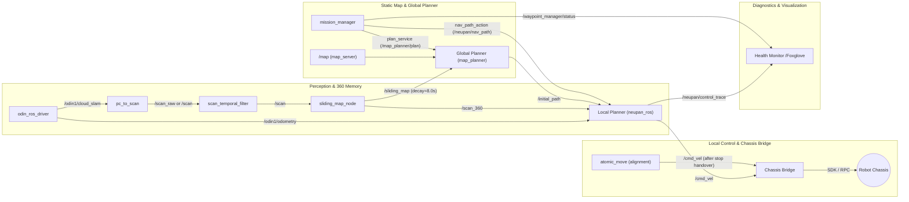
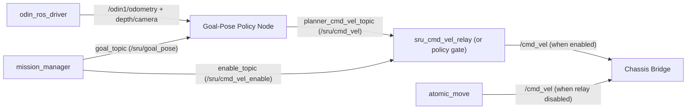
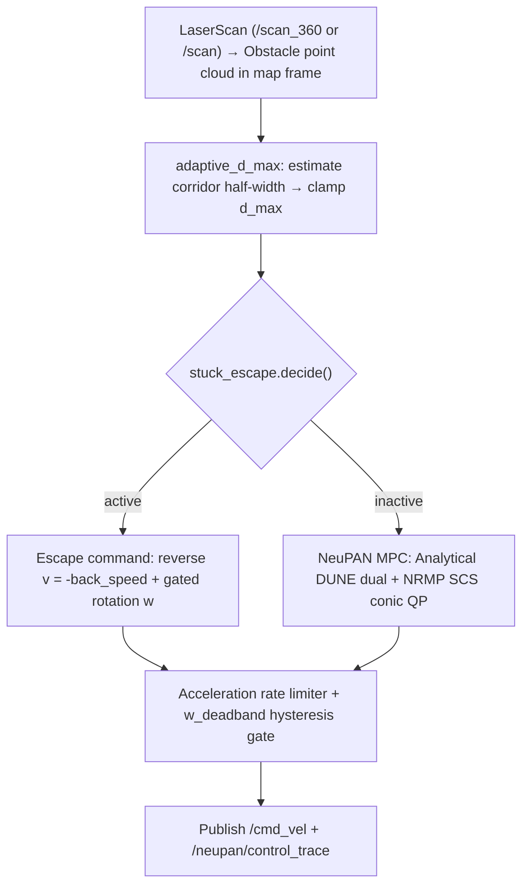

# Module I/O Dataflow & Runtime Diagnostics Map

This document provides the node-level I/O dataflow map, the per-frame NeuPAN internal control pipeline, the `stuck_escape` gate evaluation sequence, and a symptom-to-topic diagnostic table.

---

## 1. End-to-End Runtime Dataflow

### 1.1 Path-Tracking Pipeline (`local_planner_mode: action`, Default NeuPAN or Custom Tracker)

### 1.2 End-to-End Goal-Pose Pipeline (`local_planner_mode: goal_pose`, e.g., SRU or Custom Policy)

---

## 2. Node-Level I/O Reference Table

| Module | Subscribed Inputs | Published Outputs / Services | Key Config Source | Primary Diagnostic Signal |
|---|---|---|---|---|
| `odin_ros_driver` | Sensor USB / Ethernet | `/odin1/cloud_slam`, `/odin1/odometry`, TF `map->odom->imu` | `control_command.yaml` (`custom_map_mode=2`) | `rostopic hz /odin1/odometry` |
| `pc_to_scan` | `/odin1/cloud_slam` | `/scan` (or `/scan_raw`), 90° FOV (`±0.7853 rad`), `range_max=5.0 m` | `robots/<robot>/robot.yaml` (`navigation.min/max_height`) | `rostopic hz /scan` |
| `scan_temporal_filter` | `/scan_raw` | `/scan` | `enable: false` (passthrough by default) | `/scan_temporal_filter/trace` |
| `sliding_map_node` | `/scan`, `/odin1/odometry`, TF | `/scan_360`, `/sliding_map` | `robots/<robot>/robot.yaml` (`geometry.footprint`), `cell_decay_sec=8.0` | `/sliding_map` occupied cell count |
| `map_planner` | `/map`, `/sliding_map` | `/initial_path`, `/inflated_map`, srv `/map_planner/plan`, `/map_planner/validate_path` | `map_planner/config/nav_params.yaml` + `robot.yaml` overrides | Plan latency log & `/inflated_map` |
| `neupan_ros` | `/scan_360` (or `/scan`), `/initial_path`, `/odin1/odometry`, TF | `/cmd_vel`, `/neupan/replan`, `/neupan/control_trace`, act `/neupan/nav_path` | `robots/<robot>/neupan/{config,planner}.yaml` | `/neupan/control_trace` |
| `mission_manager` | `/odin1/odometry`, `/neupan/replan`, `/move_base_simple/goal` | `/waypoint_manager/status`, `/waypoint_manager/mission_feedback`, `/neupan/stop` | `robots/<robot>/robot.yaml` (`mission.*`, `local_planner.*`) | `/waypoint_manager/status` |
| `atomic_move` | TF `map -> base_link`, `/neupan/stop` | `/cmd_vel`, srv `/atomic_move/{move,turn,align}` | `mission_manager.launch` / `atomic_move.launch.py` | Alignment service response |
| `waypoint_goal_bridge` | `/waypoint/goal` | `/move_base_simple/goal`, `/waypoint/goal_bridge/status` | `ros_ws/scripts/waypoint_goal_bridge.py` / `ros2_ws/scripts/waypoint_goal_bridge.py` | `[QUEUE]` status in console |

---

## 3. NeuPAN Per-Frame Control Pipeline

---

## 4. `stuck_escape.decide()` Gate Sequence

Each control frame evaluates the following gates in order:

| # | Gate | Condition | Parameter (`config.yaml`) | Trace Field |
|---|---|---|---|---|
| 1 | **Front cone obstacle** | Nearest obstacle within `±cone_half_width_rad` (`0.9 rad`) `< front_obs_threshold` (`1.0 m`) | `front_obs_threshold: 1.0` | `front_obs` |
| 2 | **Rotation clearance gate** | 360° nearest obstacle `>= rotate_clearance_m` (`0.85 m`) required for full rotation | `rotate_clearance_m: 0.85` | `rotation_blocked`, `nearest_obs` |
| 3 | **Bounded / open rotation** | If full rotation blocked: compute bounded angle in measurable corridor, or allow rotation in open space if clearance `>= 0.57 m` | `rotate_bounded_enable`, `rotate_open_clearance_m: 0.57` | `bounded_rot`, `open_rot` |
| 4 | **Stall criterion** | `progress`: 1s window arc-length advance `< 0.05 m` (or `oscillation_detect_enable`: 4s net displacement `< 0.30 m` with travel `> 0.50 m`) | `criterion: progress`, `progress_threshold_m: 0.05` | `stuck`, `metric` |
| 5 | **Corridor guard** | Inside a symmetric corridor (`<= 1.2 m`), hold stall counter unless true standstill `>= 3.0 s` | `corridor_guard_enable: true`, `corridor_standstill_sec: 3.0` | `in_corridor`, `corridor_hold` |
| 6 | **Clearing guard** | If front obstacle distance increases by `> 0.05 m` over 1s (e.g., pedestrian walking away), hold stall counter | `clearing_guard_delta_m: 0.05` | `clearing` |
| 7 | **Frame counter** | Increment `count` by `+1` when stalled & blocked; decay by `-2` otherwise; enter escape at `trigger_frames` (`10`) | `trigger_frames: 10` | `count` |
| 8 | **Turn direction & exit** | Turn toward side with larger clearance (flip after `limit_cycle_consecutive_n: 3` identical escapes); exit when front clearance `> 1.3 m` or after `duration_sec` (`2.4 s`) and emit `/neupan/replan` | `exit_obs_distance: 1.3`, `duration_sec: 2.4` | `exited` |

---

## 5. Runtime Diagnostic Quick Reference

| Observed Symptom | First Module to Check | Topic / Field to Inspect |
|---|---|---|
| Robot backs up repeatedly without rotating | `stuck_escape` rotation gates (#2 & #3) | `rotation_blocked`, `nearest_obs` in `/neupan/escape_trace` |
| Robot waits several seconds before escaping | `stuck_escape` guards (#5 & #6) | `in_corridor`, `corridor_hold`, `clearing`, `count` |
| Path cuts through an obstacle seen moments ago | `sliding_map_node` decay / footprint | `/sliding_map` and `cell_decay_sec` (`8.0 s`) |
| Global A* path hugs walls or clips corners | `map_planner` parameters | `inflation_radius`, `obstacle_cost_safe_distance`, `line_of_sight_safe_distance` in `robot.yaml` |
| Mission pauses with `PATH_SAFETY_WAIT` (ROS 2) | `mission_manager` path safety check | `/waypoint_manager/mission_feedback` reason (`SCAN_STALE`, `DYNAMIC_MAP`, or obstacle on active path) |
| Nodes are running in ROS 2 but topics look empty | DDS domain mismatch | Ensure `export ROS_DOMAIN_ID=98` in all terminals |
