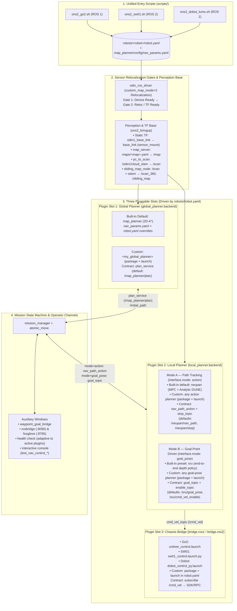
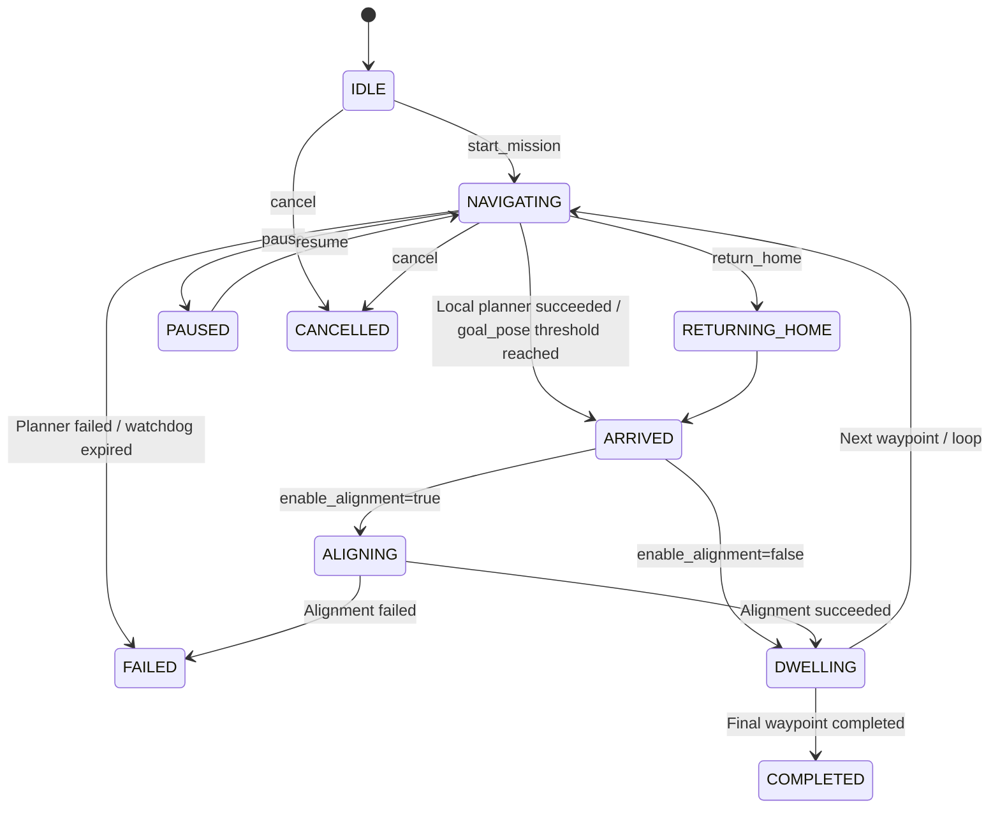

# ONS2 System Architecture

This document describes the architecture, module boundaries, runtime process topology, and pluggable interface contracts of the ONS2 navigation stack across **ROS 1 Noetic (`ros_ws/`)** and **ROS 2 Jazzy (`ros2_ws/`)**.

---

## 1. Design Goals & Principles

1. **End-to-End Inspection Navigation Loop**: Relocalization -> Multi-waypoint mission scheduling -> Global A* planning (`map_planner`) -> Local MPC + DUNE obstacle avoidance (`NeuPAN`) -> Closed-loop goal alignment (`atomic_move`) -> Return home.
2. **Robot-Agnostic Core & Single Source of Truth**: Robot-specific geometry, sensor mount TF, footprint, planner overrides, and plugin selections live exclusively in [`robots/<robot>/robot.yaml`](ROBOT_PROFILE.md).
3. **Three Pluggable Extension Slots**: Users can replace the **Global Planner** (`global_planner`), **Local Planner** (`local_planner`), or **Chassis Bridge** (`bridge`) via `robots/<robot>/robot.yaml` without modifying core C++ or launch files.
4. **Dual ROS 1 / ROS 2 Parity**: Topic, service, and action names are identical across ROS 1 (`ros_ws/`) and ROS 2 (`ros2_ws/`). Upstream NeuPAN (`NeuPAN/`) is shared directly across both runtimes.
5. **Single `/cmd_vel` Publisher Invariant**: At any instant, `/cmd_vel` is driven by at most one active controller (local planner or `atomic_move`), coordinated by explicit stop/enable handover signals from `mission_manager`.

---

## 2. Layered Architecture & Plugin Slots



---

## 3. ROS 1 vs. ROS 2 Runtime Comparison

| Dimension | ROS 1 (`ros_ws/`) | ROS 2 (`ros2_ws/`) |
|---|---|---|
| **Target OS / Distro** | Ubuntu 20.04 + ROS Noetic | Ubuntu 24.04 + ROS 2 Jazzy |
| **Entry Scripts** | `scripts/ons2_go2.sh`, `scripts/ons2_dobot_lumo.sh` | `scripts/ons2_sw01.sh` |
| **Bringup Launch** | `ons2_bringup/launch/{go2,dobot}.launch` | `ons2_bringup/launch/bringup.launch.py` |
| **Discovery** | `roscore` (`ROS_MASTER_URI`) | DDS (`ROS_DOMAIN_ID=98` across all windows) |
| **Build Tool** | `catkin_make` | `colcon build --symlink-install` |
| **Static Map Server** | `map_server` | `nav2_map_server` (configured & activated via lifecycle) |
| **NeuPAN Core** | `NeuPAN/` via `neupan_upstream_action_node.py` | `NeuPAN/` via `ros2_shim.py` + `neupan_action_node.py` |

---

## 4. Repository Layout & Package Inventory

```text
base_inspection/
├── robots/                        # Single source of truth for per-robot profiles
│   ├── _template/                 # Annotated template (robot.yaml + neupan/{config,planner}.yaml)
│   ├── go2/                       # Unitree Go2 profile & NeuPAN configs
│   ├── sw01/                      # ASTRALL SW01 profile & NeuPAN configs
│   └── dobot_lumo/                # Dobot Lumo profile & NeuPAN configs
├── NeuPAN/                        # Shared MPC + DUNE local planner core (Python, GPL-3.0)
├── ros_ws/src/                    # ROS 1 Noetic packages
│   ├── ons2_bringup/              # Profile-driven ROS 1 launch files
│   ├── nav_interfaces/            # Messages, services, and actions
│   ├── sliding_map/                   # 360-degree ego-centric virtual scan & obstacle memory
│   ├── map_planner/               # Global 2D A* planner & scan temporal filter
│   ├── neupan_ros/                # ROS 1 action server wrapper for NeuPAN
│   ├── mission_manager/           # Multi-waypoint mission state machine
│   ├── atomic_move/               # Closed-loop move / turn / align services
│   ├── unitree_control/           # Unitree Go2 SDK2 velocity bridge
│   ├── dobot_ros_control/         # Dobot Lumo RPC velocity bridge & O1L launch
│   ├── odin_brain/                # Natural-language planner & Hermes web plugin
│   ├── odin_vlm_terminal/         # VLM image query node
│   ├── pointcloud_saver/          # PCD map exporter
│   ├── pcd2pgm/                   # ROS 1 PCD-to-PGM converter
│   ├── fish2pinhole/              # Fisheye undistortion & cloud cropper
│   └── yolo_ros/                  # YOLOv5 detector & 3D object query node
├── ros2_ws/src/                   # ROS 2 Jazzy packages (1:1 core parity with ros_ws)
│   ├── ons2_bringup/              # Generic profile-driven bringup.launch.py
│   ├── nav_interfaces/            # ROS 2 IDL messages, services, and actions
│   ├── sliding_map/                   # ROS 2 360-degree virtual scan & obstacle memory
│   ├── map_planner/               # ROS 2 global A* planner & cloud/scan filters
│   ├── neupan_ros/                # ROS 2 action server + ros2_shim.py
│   ├── mission_manager/           # ROS 2 mission state machine & path safety validator
│   ├── atomic_move/               # ROS 2 closed-loop alignment node
│   ├── sw01_ros_control/          # ASTRALL SW01 SDK velocity bridge
│   ├── odin_brain/                # ROS 2 natural-language planner
│   ├── odin_vlm_terminal/         # ROS 2 VLM query node
│   └── pointcloud_saver/          # ROS 2 PCD map exporter
├── perception/                    # Standalone edge VLM inspection & person-following package
├── scripts/                       # Unified entry scripts (ons2_*.sh) & categorized tools
│   ├── lib/                       # robot_profile.py & ons2_lib.sh
│   ├── brain/                     # ASR, TTS, LLM proxy & Hermes web launchers
│   ├── tools/                     # mission_cli.sh, point_record.py, chassis_response_test.py
│   ├── systemd/                   # SW01 UDP port redirect systemd service
│   └── map_processing/            # pcd_to_pgm.py, pgm_to_irsim_world.py, 3DGS converters
└── docs/                          # Documentation
    ├── usage/                     # 01_quick_start, 02_parameter_tuning, 03_integrate_your_robot
    ├── architecture/              # ROBOT_PROFILE.md, ONS2_ARCHITECTURE.md, MODULE_DATAFLOW.md
    └── TUNING_GUIDE.md            # Detailed parameter dictionary & troubleshooting reference
```

---

## 5. Core Modules & Runtime Behavior

### 5.1 Sensor Driver & Relocalization Gates (`odin_ros_driver`)
- Before starting the driver (when `--mock-odin` is not set), `ons2_prepare_odin_reloc_config` in `scripts/lib/ons2_lib.sh` enforces `custom_map_mode: 2` (`0: Odometry | 1: SLAM | 2: Relocalization`), `use_host_ros_time: 1`, and sets `relocalization_map_abs_path` to `customer_file/<map>.bin`.
- **Gate 1** waits for `Device ready and streams activated`; **Gate 2** waits for `relocalization success` (or `odom -> map` TF on O1L) before launching downstream navigation nodes.

### 5.2 Perception Chain (`pc_to_scan` -> `scan_temporal_filter` -> `sliding_map`)
- **`pc_to_scan`**: Projects `/odin1/cloud_slam` into `odin1_base_link` using `navigation.min_height` and `navigation.max_height` from `robots/<robot>/robot.yaml`.
- **`sliding_map`**: Compensates for the forward sensor's ~90-degree horizontal FOV by accumulating scans in an ego-centric grid (`/sliding_map` and 360-degree `/scan_360`), filtering out returns inside the robot's own footprint (`geometry.footprint` in `robot.yaml`), and decaying blind-spot cells after `cell_decay_sec` (`8.0 s`) while immediately clearing cells traversed by visible free rays.

### 5.3 Pluggable Global Planner (`global_planner`)
- **Default (`map_planner`)**: 8-connected 2D A* with hard obstacle inflation (`inflation_radius`), soft proximity cost (`obstacle_cost_safe_distance`, `obstacle_cost_weight`), line-of-sight shortcutting (`line_of_sight_safe_distance`), and Laplacian smoothing. Shared algorithm defaults live in `map_planner/config/nav_params.yaml`; per-robot overrides live in `robots/<robot>/robot.yaml`.
- **Custom Global Planner**: Selected via `global_planner.backend` in `robot.yaml` (or `--global-planner=<name>`). Must advertise `plan_service` (default `/map_planner/plan`, `nav_interfaces/srv/PlanPath`). Optional services (`/map_planner/validate_path` and `/map_planner/plan_sequence`) are skipped automatically when not advertised.

### 5.4 Pluggable Local Planner (`local_planner`)
Selected via `local_planner.backend` in `robot.yaml` (or `--local-planner=<name>`). Supports two interface modes via `interface.mode`, each with a built-in implementation and configurable ROS topic/action names for custom planners:
- **Mode A — Path Tracking (`interface.mode: action`)**:
  - **Built-in default (`neupan`)**: Model Predictive Control (MPC) coupled with analytical DUNE (`dune_use_analytic: true`) and SCS conic QP (`NRMP`), plus `adaptive_d_max` and `stuck_escape`. Configured in `robots/<robot>/neupan/{config,planner}.yaml`.
  - **Custom action planner**: Any path-tracking local planner (launched via `package + launch` in `robot.yaml` or externally).
  - **Contract**: Tracks the global path via `nav_path_action` (default `/neupan/nav_path`) and aborts on `stop_topic` (default `/neupan/stop`).
- **Mode B — Goal-Point Driven (`interface.mode: goal_pose`)**:
  - **Built-in preset (`sru`)**: End-to-end depth policy with spatially-enhanced recurrent memory.
  - **Custom goal-pose planner**: Any goal-driven local planner (launched via `package + launch` in `robot.yaml` or externally).
  - **Contract**: Bypasses global A* planning; receives the active waypoint directly on `goal_topic` (default `/sru/goal_pose`) gated by `enable_topic` (default `/sru/cmd_vel_enable`).

### 5.5 Mission State Machine (`mission_manager`) & Alignment (`atomic_move`)



- Upon reaching a waypoint (`ARRIVED`), `mission_manager` publishes `stop_topic` (`/neupan/stop`) and disables `enable_topic` (`/sru/cmd_vel_enable`) to guarantee exclusive `/cmd_vel` ownership before invoking `atomic_move` (`/atomic_move/align`) for closed-loop final yaw alignment.
